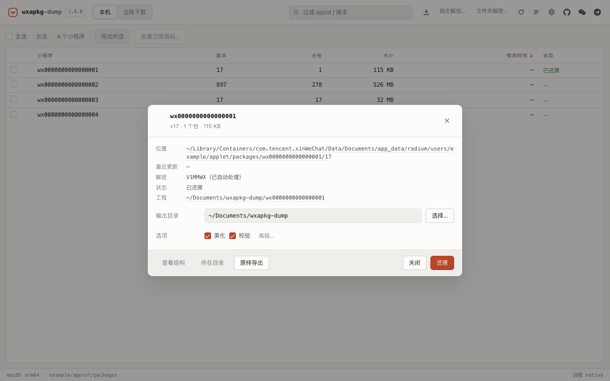
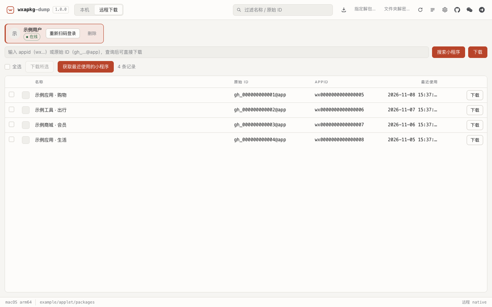
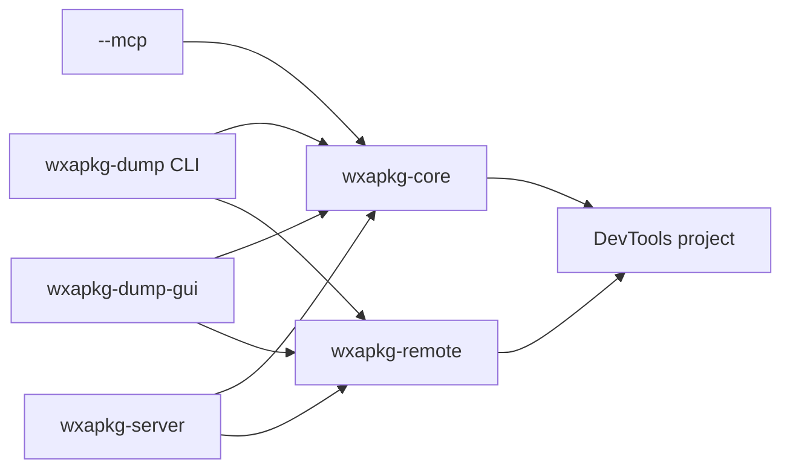

<div align="center">
  
  <h1>wxapkg-dump</h1>
  <p><strong>WeChat Mini Program package toolkit — decompile, download, and restore a DevTools-ready project</strong></p>
  <p>
    <a href="https://github.com/RYF5584/wxapkg-dump/releases"></a>
    <a href="LICENSE"></a>
    
    <a href="https://github.com/RYF5584/wxapkg-dump/actions/workflows/ci.yml"></a>
  </p>
  <p>
    <a href="README.md">简体中文</a> ·
    <a href="docs/cli.md">CLI</a> ·
    <a href="docs/api.md">HTTP API</a> ·
    <a href="docs/architecture.md">Architecture</a> ·
    <a href="docs/conventions.md">Conventions</a>
  </p>
</div>

> For learning, security research, and analysis of Mini Programs you are **authorised** to inspect. Follow the WeChat license and local law; do not use it against programs you do not own.

## Why

The WeChat client caches Mini Programs as compiled `wxapkg` data: WXML is opcode-based, WXSS is split into fragments, and JS modules plus page config are spread across packages. `wxapkg-dump` turns that back into a project the **official WeChat DevTools can import**, including PC `V1MMWX` decryption, sub-packages, plugin placeholders, and the template repairs that commonly block compilation.

One command:

```bash
wxapkg-dump unpack --appid wx1234567890abcdef -o ./out --beautify
```

## Features

- **Local extraction** — scan WeChat 3.x / 4.x caches on macOS and Windows, decrypt by appid, reconstruct.
- **Remote download** — scan-to-login, then fetch main package, sub-packages and resource widgets by appid or original id.
- **DevTools-ready** — repairs bare `wx:*` directives, template `data`, Skyline config, WXSS root blocks and page JSON.
- **Beautify & verify** — format JS / WXML / WXSS / JSON; validate structure, references and real JavaScript syntax.
- **Four surfaces, one engine** — CLI, desktop GUI, HTTP API, and `wxapkg-dump --mcp`.
- **One binary** — MCP is embedded; there is no separate `wxapkg-mcp`.

### How it compares

| Capability | Typical Node / Python scripts | wxapkg-dump |
|---|---|---|
| Runtime | Node or Python plus third-party dependencies | One Rust binary, no runtime dependency |
| DevTools import | Often needs manual WXML/config repair | Built-in repairs for directives, templates, Skyline, WXSS and page JSON |
| Platforms | Varies by script | macOS / Windows / Linux from one implementation |
| Remote download | Usually absent | Scan-to-login, then main and sub-packages by appid |
| Interfaces | A command-line script | CLI, desktop GUI, HTTP API and MCP |

## Install

Download the package for your platform from [Releases](https://github.com/RYF5584/wxapkg-dump/releases):

| Platform | CLI | Desktop |
|---|---|---|
| macOS Apple Silicon | [tar.gz](https://github.com/RYF5584/wxapkg-dump/releases/latest/download/wxapkg-dump-macos-arm64.tar.gz) | [DMG](https://github.com/RYF5584/wxapkg-dump/releases/latest/download/wxapkg-dump-macos-arm64.dmg) |
| macOS Intel | [tar.gz](https://github.com/RYF5584/wxapkg-dump/releases/latest/download/wxapkg-dump-macos-x64.tar.gz) | [DMG](https://github.com/RYF5584/wxapkg-dump/releases/latest/download/wxapkg-dump-macos-x64.dmg) |
| Windows x64 | [ZIP](https://github.com/RYF5584/wxapkg-dump/releases/latest/download/wxapkg-dump-windows-x64.zip) | [ZIP](https://github.com/RYF5584/wxapkg-dump/releases/latest/download/wxapkg-dump-gui-windows-x64.zip) |
| Linux x64 | [tar.gz](https://github.com/RYF5584/wxapkg-dump/releases/latest/download/wxapkg-dump-linux-x64.tar.gz) | [tar.gz](https://github.com/RYF5584/wxapkg-dump/releases/latest/download/wxapkg-dump-gui-linux-x64.tar.gz) |

CLI and desktop app are shipped separately: `.tar.gz` / `.dmg` on macOS, two ZIPs on Windows, and two tarballs on Linux. Every link points at the `latest` GitHub Release, so it survives version bumps. The repository never commits binaries; release assets are published only through GitHub Releases.
The macOS build is not notarised: right-click → Open the first time, or run `xattr -dr com.apple.quarantine /Applications/wxapkg-dump-gui.app`.

**Prerequisites:** the CLI has no runtime dependency. The desktop app needs macOS 11+, Windows 10+ (WebView2) or Linux with WebKitGTK 4.1. Building the CLI from source needs Rust 1.88+; the desktop app needs Rust 1.90+. `verify --node` additionally needs Node. On macOS, allow the "access data from other apps" prompt on first scan, or the list may stay empty.

Or build from source:

```bash
cargo build --release -p wxapkg-cli
# Optional desktop app
cd crates/wxapkg-gui && cargo build --release
```


## Quick start

### Local Mini Programs

```bash
wxapkg-dump scan                              # list local caches
wxapkg-dump info  ./main.wxapkg               # inspect a container
wxapkg-dump unpack --appid wx1234567890abcdef -o ./out  # restore a project
wxapkg-dump verify ./out/wx1234567890abcdef --node      # structure + JS syntax
wxapkg-dump beautify ./out/wx1234567890abcdef           # format only
```

Selecting a file or folder restores beside the input:

```text
dir/app.wxapkg            → dir/unpack_wx1234567890abcdef/
folder/                   → folder/unpack_wx1234567890abcdef/        (one per appid)
folder/ (no appid)        → folder/unpack_<folder-name>/
```

### Remote download

```bash
wxapkg-dump login                              # scan a QR; one account is remembered
wxapkg-dump recent                             # recently used
wxapkg-dump download wx1234567890abcdef --out ./remote \
  --unpack --beautify                          # download + restore + format
```

Layout:

```text
remote/
└── original_wxapkg/
    └── wx1234567890abcdef/
        └── wxapkg/
            ├── manifest.json
            ├── wx1234567890abcdef_<module>_t4.wxapkg
            └── unpack_wx1234567890abcdef/   ← import this in DevTools
```

### Desktop app

The release package ships `wxapkg-dump-gui` (a `.app` on macOS). `wxapkg-dump --gui` locates it next to the CLI (or via `WXAPKG_GUI`) and starts it:

```bash
wxapkg-dump-gui        # start the desktop app directly
wxapkg-dump --gui      # start the same app through the CLI
```

- Local table with multi-select, batch restore, row details and context menu.
- Remote tab auto-loads the recent list once when signed in and not yet loaded.
- Download options: output directory, restore after download, beautify, resource widgets.

### MCP

```json
{
  "mcpServers": {
    "wxapkg-dump": {
      "command": "wxapkg-dump",
      "args": ["--mcp"]
    }
  }
}
```

Nine tools cover scanning, inspection, restore, raw export, beautify, account status, recent programs, remote info and download. JSON-RPC 2.0 over stdio.

### HTTP API

```bash
wxapkg-dump --server --bind 127.0.0.1:8788
# docs: http://127.0.0.1:8788/docs
```

Binding a non-loopback address requires `--allow-remote`; set `--admin-key` as well.

## Screenshots

| Local | Remote |
|---|---|
|  |  |

## Output layout

One project per appid. All sub-packages live in the same tree; `_raw/` keeps the original containers and is excluded by `packOptions.ignore`.

```text
out/
└── wx1234567890abcdef/
    ├── app.js / app.json / app.wxss
    ├── project.config.json
    ├── sitemap.json
    ├── pages/ components/ miniprogram_npm/
    ├── _raw/
    ├── _foreign/
    └── _unpack_report.json
```

Beautify only changes file contents, never the layout. Remote downloads also keep `manifest.json` and every `.wxapkg` for auditing.

## Platform support

| Capability | macOS | Windows | Linux |
|---|:---:|:---:|:---:|
| Local scan / decrypt / restore | ✅ | ✅ | ✅ |
| Remote login / download | ✅ | ✅ | ✅ |
| Desktop GUI | ✅ | ✅ | ✅ |
| MCP (`--mcp`) | ✅ | ✅ | ✅ |

Long paths, illegal filename characters and case differences are handled on every platform; `plugin-private://` entries are normalised to safe, identical trees.

## Architecture



- `wxapkg-core` — containers, decryption, decompilation, project rebuild, beautify, verify. No UI dependency.
- `wxapkg-remote` — pure-Rust MMTLS / iLink / UAL and account storage.
- `wxapkg-cli` — the command-line executable; also serves `--server`, `--gui` and `--mcp`. The desktop app is the separate `wxapkg-dump-gui`.
- `wxapkg-server` — HTTP API; `wxapkg-dump-gui` (`crates/wxapkg-gui`) — Tauri desktop shell.

## Documentation

| Document | Contents |
|---|---|
| [docs/cli.md](docs/cli.md) | commands, flags, JSON output and exit codes |
| [docs/api.md](docs/api.md) | HTTP API and OpenAPI |
| [docs/remote.md](docs/remote.md) | remote login, protocol and storage |
| [docs/architecture.md](docs/architecture.md) | layers, data flow, module boundaries |
| [docs/conventions.md](docs/conventions.md) | layout, naming, errors, i18n, tests |
| [docs/wxapkg-dump.1](docs/wxapkg-dump.1) | man page |
| [skills/wxapkg-dump/SKILL.md](skills/wxapkg-dump/SKILL.md) | assistant skill |

## Development

```bash
cargo fmt --all
cargo clippy --workspace --all-targets -- -D warnings
cargo test --workspace
```

Desktop:

```bash
cd crates/wxapkg-gui
cargo test --release
cargo build --release
```

Release: push a `v*` tag; GitHub Actions builds CLI and GUI for macOS (arm64 / x86_64), Linux x86_64 and Windows x86_64.

## Contributing

Read [CONTRIBUTING.md](CONTRIBUTING.md) and [CODE_OF_CONDUCT.md](CODE_OF_CONDUCT.md). Report security issues privately per [SECURITY.md](SECURITY.md), not in a public issue.

## Contact

- WeChat: `RSCompanyCEO`
- Telegram: [ryf5584](https://t.me/ryf5584)
- GitHub: [ryf5584](https://github.com/ryf5584)

## License

[MIT](LICENSE) © wxapkg-dump contributors
