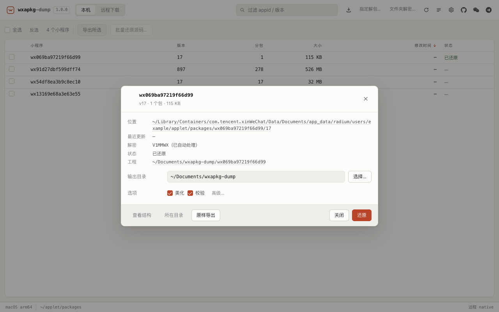
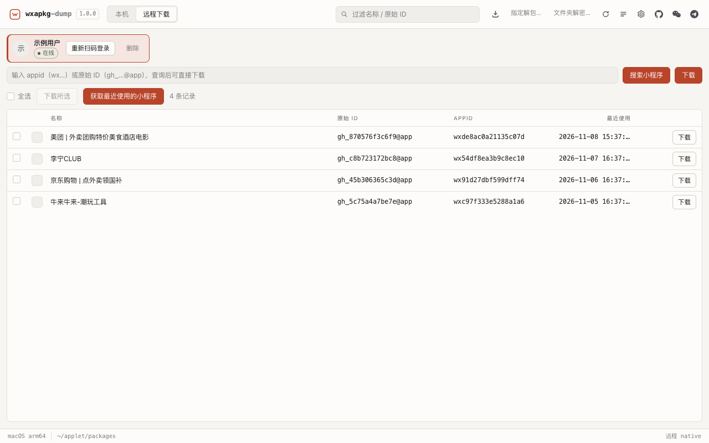
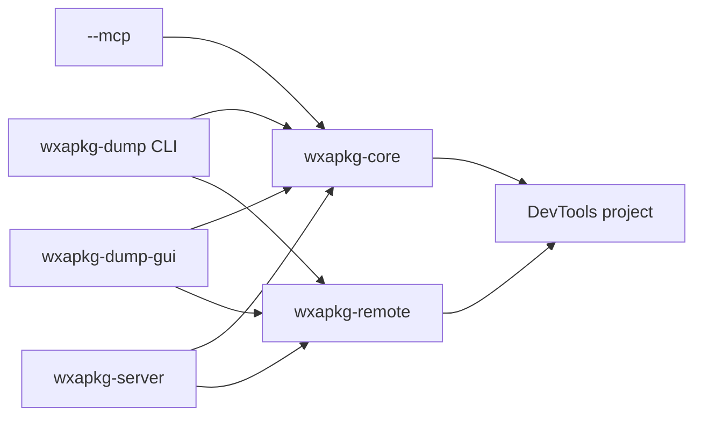

<div align="center">
  
  <h1>wxapkg-dump</h1>
  <p><strong>微信小程序包解析、反编译、远程下载与 DevTools 一键还原</strong></p>
  <p>
    <a href="https://github.com/RYF5584/wxapkg-dump/releases"></a>
    <a href="LICENSE"></a>
    
    <a href="https://github.com/RYF5584/wxapkg-dump/actions/workflows/ci.yml"></a>
  </p>
  <p>
    <a href="README.en.md">English</a> ·
    <a href="docs/cli.md">CLI</a> ·
    <a href="docs/api.md">HTTP API</a> ·
    <a href="docs/architecture.md">架构</a> ·
    <a href="docs/conventions.md">规范</a>
  </p>
</div>

> 仅用于学习、安全研究与**已获授权**的小程序分析。请遵守微信软件许可协议与当地法律；不要用它分析不属于你的程序。

## 为什么用它

微信把小程序缓存成编译后的 `wxapkg`：WXML 是操作码、WXSS 被拆成片段、JS 模块与页面配置散落在多个包里。`wxapkg-dump` 把这些碎片还原成 **微信开发者工具可以直接导入的工程**，并负责处理 PC 端 `V1MMWX` 加密、分包、插件占位与常见的模板语法修复。

一条命令完成：

```bash
wxapkg-dump unpack --appid wx069ba97219f66d99 -o ./out --beautify
```

## 功能

- **本机提取**：扫描微信 3.x / 4.x 缓存（Windows、macOS），按 appid 解密并还原。
- **远程下载**：扫码登录应用宝，按 appid 或原始 ID 下载主包、分包与资源包。
- **DevTools 可用**：修复裸 `wx:*` 指令、`template data`、Skyline 配置、WXSS 根选择器、页面 JSON 等问题。
- **美化与校验**：JS / WXML / WXSS / JSON 格式化；结构、引用与真实 JS 语法检查。
- **四种入口，同一引擎**：CLI、桌面 GUI、HTTP API，以及 `wxapkg-dump --mcp`。
- **单二进制**：MCP 已并入 CLI，不再单独发布 `wxapkg-mcp`。

### 与其他解包方案的区别

| 能力 | 常见 Node / Python 脚本 | wxapkg-dump |
|---|---|---|
| 运行环境 | 需要 Node 或 Python 及第三方依赖 | 单个 Rust 二进制，无运行时依赖 |
| DevTools 直接导入 | 常需手工修 WXML / 配置 | 内置指令、模板、Skyline、WXSS、页面 JSON 修复 |
| 平台覆盖 | 因脚本而异 | macOS / Windows / Linux，同一份实现 |
| 远程下载 | 通常没有 | 扫码登录后按 appid 下载主包与分包 |
| 界面与集成 | 命令行脚本 | CLI、桌面 GUI、HTTP API、MCP |

## 安装

从 [Releases](https://github.com/RYF5584/wxapkg-dump/releases) 下载对应平台包：

| 平台 | CLI | 桌面程序 |
|---|---|---|
| macOS Apple Silicon | [tar.gz](https://github.com/RYF5584/wxapkg-dump/releases/latest/download/wxapkg-dump-macos-arm64.tar.gz) | [DMG](https://github.com/RYF5584/wxapkg-dump/releases/latest/download/wxapkg-dump-macos-arm64.dmg) |
| macOS Intel | [tar.gz](https://github.com/RYF5584/wxapkg-dump/releases/latest/download/wxapkg-dump-macos-x64.tar.gz) | [DMG](https://github.com/RYF5584/wxapkg-dump/releases/latest/download/wxapkg-dump-macos-x64.dmg) |
| Windows x64 | [ZIP](https://github.com/RYF5584/wxapkg-dump/releases/latest/download/wxapkg-dump-windows-x64.zip) | [ZIP](https://github.com/RYF5584/wxapkg-dump/releases/latest/download/wxapkg-dump-gui-windows-x64.zip) |
| Linux x64 | [tar.gz](https://github.com/RYF5584/wxapkg-dump/releases/latest/download/wxapkg-dump-linux-x64.tar.gz) | [tar.gz](https://github.com/RYF5584/wxapkg-dump/releases/latest/download/wxapkg-dump-gui-linux-x64.tar.gz) |

CLI 与桌面程序分别打包：macOS 使用 `.tar.gz` / `.dmg`，Windows 使用两个独立 ZIP，Linux 使用两个独立 tar.gz。所有下载链接都指向 GitHub Releases 的 `latest`，不会随版本号变化失效。仓库本身不提交任何编译产物，二进制只通过 Releases 发布。
发布包未做 Apple 公证，首次打开请右键选择“打开”，或执行 `xattr -dr com.apple.quarantine /Applications/wxapkg-dump-gui.app`。

**前置条件**：命令行不依赖运行时；桌面端需要 macOS 11+、Windows 10+（WebView2）或带 WebKitGTK 4.1 的 Linux。从源码构建需要 Rust 1.88+；`verify --node` 额外需要 Node。macOS 首次扫描若弹出“访问其他 App 的数据”，请允许，否则列表可能为空。

或从源码构建：

```bash
cargo build --release -p wxapkg-cli
# 可选桌面程序
cd crates/wxapkg-gui && cargo build --release
```


## 快速开始

### 本机小程序

```bash
wxapkg-dump scan                              # 列出本机缓存
wxapkg-dump info  ./main.wxapkg               # 查看容器结构
wxapkg-dump unpack --appid wx069... -o ./out  # 还原工程
wxapkg-dump verify ./out/wx069... --node      # 结构 + JS 语法校验
wxapkg-dump beautify ./out/wx069...           # 只做格式化
```

用户直接选文件或文件夹时，工程生成在所选位置旁边：

```text
dir/app.wxapkg            → dir/unpack_wx069.../
folder/                   → folder/unpack_wx069.../        （每个 appid 一个）
folder/（无 appid 的容器）  → folder/unpack_<文件夹名>/
```

### 远程下载

```bash
wxapkg-dump login                              # 扫码；账号只保留一个
wxapkg-dump recent                             # 最近使用
wxapkg-dump download wx069... --out ./remote \
  --unpack --beautify                          # 下载 + 还原 + 美化
```

输出固定为：

```text
remote/
└── original_wxapkg/
    └── wx069ba97219f66d99/
        └── wxapkg/
            ├── manifest.json
            ├── wx069..._<module>_t4.wxapkg
            └── unpack_wx069ba97219f66d99/   ← DevTools 导入这一层
```

### 桌面程序

发布包里的 `wxapkg-dump-gui`（macOS 为 `.app`）是独立的桌面程序；`wxapkg-dump --gui` 会在同目录或 `WXAPKG_GUI` 指定的位置找到它并启动：

```bash
wxapkg-dump-gui        # 直接启动桌面程序
wxapkg-dump --gui      # 通过 CLI 启动同一桌面程序
```

- 本机列表支持多选、批量还原、详情与右键菜单。
- 远程页在已登录且尚未加载时**自动获取最近使用**。
- 下载选项：输出目录、下载后还原、美化、资源包。

### MCP

```json
{
  "mcpServers": {
    "wxapkg-dump": {
      "command": "wxapkg-dump",
      "args": ["--mcp"]
    }
  }
}
```

9 个工具覆盖扫描、容器检查、还原、原样导出、美化、账号状态、最近列表、远程信息与下载。协议为 JSON-RPC 2.0 over stdio。

### HTTP API

```bash
wxapkg-dump --server --bind 127.0.0.1:8788
# 文档：http://127.0.0.1:8788/docs
```

绑定非回环地址必须显式 `--allow-remote`；建议同时设置 `--admin-key`。

## 界面

| 本机 | 远程下载 |
|---|---|
|  |  |

## 输出结构

一个 appid 一个工程；所有分包展开在同一工程内，`_raw/` 保存原始容器副本并已被 `packOptions.ignore` 排除。

```text
out/
└── wx069ba97219f66d99/
    ├── app.js / app.json / app.wxss
    ├── project.config.json
    ├── sitemap.json
    ├── pages/ components/ miniprogram_npm/
    ├── _raw/
    ├── _foreign/
    └── _unpack_report.json
```

美化只改变文件内容，不改变目录结构。远程下载额外保留 `manifest.json` 与全部 `.wxapkg`，便于复核。

## 支持矩阵

| 能力 | macOS | Windows | Linux |
|---|:---:|:---:|:---:|
| 本机扫描 / 解密 / 还原 | ✅ | ✅ | ✅ |
| 远程登录 / 下载 | ✅ | ✅ | ✅ |
| 桌面 GUI | ✅ | ✅ | ✅ |
| MCP（`--mcp`） | ✅ | ✅ | ✅ |

每个平台都处理了长路径、非法文件名字符与大小写差异；容器条目中的 `plugin-private://` 会规范化为跨平台安全的目录名。

## 架构



- `wxapkg-core`：容器、解密、反编译、工程重建、美化、校验，无 UI 依赖。
- `wxapkg-remote`：纯 Rust 的 MMTLS / iLink / UAL 与会话存储。
- `wxapkg-cli`：命令行可执行文件，同时承载 `--server`、`--gui`、`--mcp`；桌面端另有 `wxapkg-dump-gui`。
- `wxapkg-server`：HTTP API；`wxapkg-dump-gui`（`crates/wxapkg-gui`）：Tauri 桌面端。

## 文档

| 文档 | 内容 |
|---|---|
| [docs/cli.md](docs/cli.md) | 所有子命令、参数、JSON 输出与退出码 |
| [docs/api.md](docs/api.md) | HTTP API 与 OpenAPI |
| [docs/remote.md](docs/remote.md) | 远程登录、协议与账号存储 |
| [docs/architecture.md](docs/architecture.md) | 分层、数据流与模块边界 |
| [docs/conventions.md](docs/conventions.md) | 目录、命名、错误码、i18n、测试规范 |
| [docs/wxapkg-dump.1](docs/wxapkg-dump.1) | man 手册 |
| [skills/wxapkg-studio/SKILL.md](skills/wxapkg-studio/SKILL.md) | AI 助手 Skill |

## 开发

```bash
cargo fmt --all
cargo clippy --workspace --all-targets -- -D warnings
cargo test --workspace
```

桌面端：

```bash
cd crates/wxapkg-gui
cargo test --release
cargo build --release
```

发布：推送 `v*` tag，GitHub Actions 会为 macOS（arm64 / x86_64）、Linux x86_64、Windows x86_64 构建并打包 CLI 与 GUI。

## 贡献

请先阅读 [CONTRIBUTING.md](CONTRIBUTING.md) 与 [CODE_OF_CONDUCT.md](CODE_OF_CONDUCT.md)。安全问题请按 [SECURITY.md](SECURITY.md) 私下报告，不要公开提 issue。

## 联系

- WeChat：`RSCompanyCEO`
- Telegram：[ryf5584](https://t.me/ryf5584)
- GitHub：[ryf5584](https://github.com/ryf5584)

## 许可

[MIT](LICENSE) © wxapkg-dump contributors
